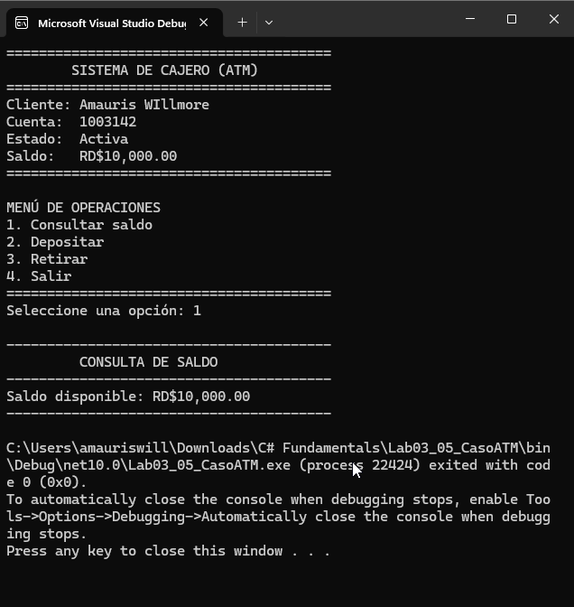
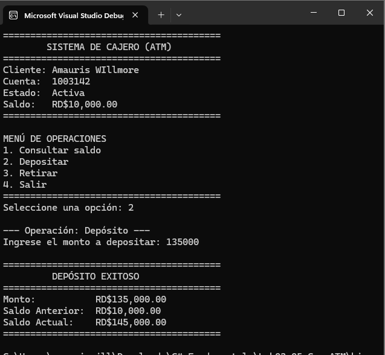

# Caso ATM — Validaciones y Menú de Operaciones

Prototipo de cajero automático en C# (.NET 10) con validaciones de consulta, depósito y retiro bajo la especificación BRD-ATM-001.

## Evidencia de Ejecución

